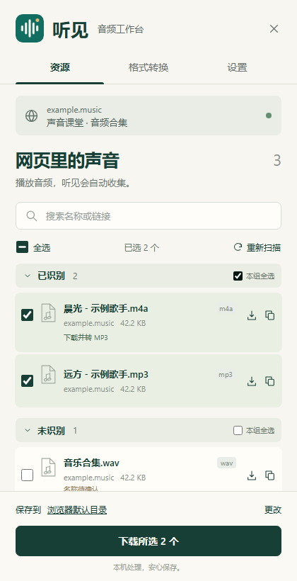
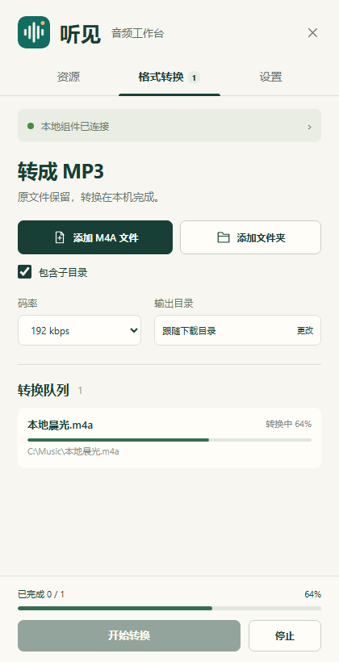

# 听见 · 音频下载工作台

听见是适用于 **Microsoft Edge / Chrome** 的 Manifest V3 浏览器扩展。网页播放音频时，它会收集可下载的音频资源，在常驻侧栏里按名称分组，支持批量下载，并通过可选的 Windows 本地组件完成自定义文件夹保存和 **M4A → MP3** 转换。

当前扩展版本：**2.0.5**。

**普通音频识别、复制链接和浏览器下载不需要启动本地服务，也不需要安装 Node.js。** 本地组件只用于自定义文件夹和格式转换，由浏览器按需启动；没有需要手动保持运行的 HTTP 服务。

## 目录

- [功能](#功能)
- [安装扩展](#安装扩展)
- [日常使用](#日常使用)
- [可选：安装 Windows 本地组件](#可选安装-windows-本地组件)
- [识别与名称规则](#识别与名称规则)
- [2.0.5 更新说明](#205-更新说明)
- [权限与数据](#权限与数据)
- [开发、构建与测试](#开发构建与测试)
- [项目结构](#项目结构)
- [故障排查](#故障排查)
- [支持范围与限制](#支持范围与限制)

## 功能

| 功能 | 说明 | 需要本地组件 |
| --- | --- | --- |
| 网页音频发现 | 监听音频响应，扫描播放器、音频链接、动态元素及子框架 | 否 |
| 名称补全 | 使用明确关联的歌名、歌手、元素文字与文件名，减少乱码名称 | 否 |
| 分组与搜索 | 已识别 / 未识别两组，搜索、按组全选、批量选择 | 否 |
| 常驻侧栏 | 点击网页或切换同一窗口的标签页时保持开启 | 否 |
| 普通下载 | 使用浏览器默认目录，支持下载前询问保存位置 | 否 |
| 自定义下载目录 | 通过系统对话框选择文件夹，批量保存到该目录 | 是 |
| 下载并转 MP3 | 下载 M4A，保留原文件，再加入转换队列 | 是 |
| 本地批量转换 | 添加 M4A 文件 / 文件夹，可包含子目录，选择码率与输出目录 | 是 |

转换支持 AAC / ALAC 编码的 M4A，输出为 44.1 kHz 双声道 MP3；码率可选 128 / 192 / 256 / 320 kbps，默认 320 kbps。原文件保留，同名输出自动编号，并尽量保留可用的文字标签。

项目另保留独立的 Windows 桌面转换器，见 [转换器说明](converter/README.md)。

<details>
<summary>查看资源与格式转换界面（演示数据）</summary>

| 资源与名称分组 | 本地批量转换 |
| --- | --- |
|  |  |

</details>

## 安装扩展

### 方式一：直接加载源码

扩展本身是原生 JavaScript / HTML / CSS，**源码加载无需编译、npm install 或运行开发服务器**。

1. 克隆仓库，或使用 GitHub 的 **Code → Download ZIP** 下载源码并完整解压。

   ```powershell
   git clone https://github.com/liujunfei678/tingjian-download.git
   cd tingjian-download
   ```

2. 打开扩展管理页：
   - Edge：在地址栏输入 `edge://extensions`。
   - Chrome：在地址栏输入 `chrome://extensions`。
3. 开启“开发者模式”，点击“加载解压缩的扩展”或“加载已解压的扩展程序”。
4. 选择仓库里的 **`extension` 文件夹**，该文件夹应直接包含 `manifest.json`。不要选择仓库根目录，也不要直接选择 ZIP。
5. 在浏览器工具栏中固定听见图标。刷新准备使用的音频网页，点击听见图标打开侧栏。

请把源码放在固定位置。浏览器会继续从所选文件夹读取扩展，移动或删除该目录会影响后续使用。

### 方式二：自行生成扩展安装包

仓库保存源码；`dist/` 是本地构建产物目录，**克隆后不包含现成 ZIP 或 EXE**。需要 ZIP 时，可在 Windows 上安装 Node.js 后运行：

```powershell
node scripts/package.mjs
```

输出为 `dist/tingjian-audio-downloader-v2.0.5.zip`。将它解压到固定目录，再按上面的步骤加载直接包含 `manifest.json` 的目录。ZIP 不能直接安装；此打包脚本调用 Windows PowerShell，不需要 npm 依赖。

### 更新已安装的听见

1. 更新原先加载的扩展目录中的文件。
2. 在扩展管理页点击听见卡片上的“重新加载”，确认显示目标版本号。
3. 刷新已打开的音频网页，再播放歌曲；旧内容脚本和旧播放器信息不会因磁盘文件更新而自动替换。

2.x 使用固定扩展 ID：`lncnlaidcmglpbnfmikaocnhocjifghn`。请保留 `extension/manifest.json` 中的 `key`，它用于保持 ID 与本地组件的来源授权一致。从未固定 ID 的 1.x 安装升级时，浏览器可能将其视为另一个扩展，需要移除旧版并重新设置偏好。不要同时启用两份听见。

## 日常使用

### 发现和下载网页音频

1. 打开网页并播放音频。听见会自动收集当前标签页的资源。
2. 点击听见图标，在“资源”中查看“已识别”和“未识别”分组。
3. 可搜索名称或链接，逐项选择，也可使用“本组全选”。点击单项下载图标或底部“下载所选音频”。
4. 如资源尚未出现，可在播放后点击“重新扫描”。需要重新开始时使用“清空列表”。

默认使用浏览器的下载目录。可在“设置”中启用“下载前询问保存位置”，让浏览器在下载时显示保存对话框。要让多个文件自动保存到同一个任意文件夹，请使用下方的本地组件和自定义目录模式。

侧栏跟随同一浏览器窗口的活动标签页，每个标签页分别保留资源、搜索和选中状态。点击网页或切换标签页不会自动关闭侧栏；点击听见右上角或浏览器侧栏的关闭按钮才关闭。**关闭侧栏不会停止已经开始的下载或转换。**

### 选择下载文件夹

1. 安装并连接本地组件。
2. 进入“设置”，选择自定义下载目录，通过系统文件夹对话框选定位置。
3. 后续单项或批量下载使用该目录，不需要逐个选择保存位置。可随时切回浏览器默认目录。

自定义下载仍由浏览器发起，保留原 URL 签名参数和浏览器适用的登录状态。文件先进入听见独占的浏览器暂存位置，再由本地组件复制并发布到所选目录；不会覆盖已有同名文件。保存成功后清理对应暂存文件，最终文件及状态可在工作台查看。目录不可写等失败会保留可重试来源。

### M4A 转 MP3

有两种入口：

- **网页资源**：在 M4A 资源下点击“下载并转 MP3”，先保存原始 M4A，再提交转换。
- **已有本地文件**：打开“格式转换”，添加文件或文件夹，按需勾选“包含子目录”，选择码率、输出目录后开始。

转换输出默认跟随下载目录，也可单独选择输出目录，再恢复跟随。超过 200 首的列表会分批提交。停止后已完成的文件保留，失败或中断任务可以重试。

浏览器退出或本地组件断开时，未完成的转换会记录为中断，重新连接后可重试。转换只保留可用文字标签，不保证保留封面或原有目录结构。

## 可选：安装 Windows 本地组件

### 是否需要安装

只使用音频识别、复制链接或浏览器普通下载时，可以跳过本节。**自定义任意下载文件夹和 M4A 转 MP3 才需要安装。**

组件支持 Windows 10 / 11 x64，使用 Native Messaging 与浏览器通信。它不是网站服务器，不需要手动启动服务，不添加开机启动项。

### 从源码构建

仓库不携带预编译的本地组件。构建环境需要：

- Windows x64、Node.js。
- Windows .NET Framework C# 编译器，默认路径为 `%WINDIR%\Microsoft.NET\Framework64\v4.0.30319\csc.exe`；可用 `CSC_PATH` 指定其他位置。
- 可执行的 `ffmpeg.exe`，并包含 `libmp3lame` 编码器；可放入 PATH 或设置 `FFMPEG_PATH`。
- FFmpeg 发行包的许可与构建说明：脚本要求 `ffmpeg.exe` 上两级目录内有 `LICENSE` 和 `README.txt`，并将其复制到组件包。当前脚本按 Gyan essentials 发行包的目录形式处理，不会自动下载 FFmpeg。

典型 FFmpeg 目录结构：

```text
ffmpeg/
├─ LICENSE
├─ README.txt
└─ bin/
   ├─ ffmpeg.exe
   └─ ffprobe.exe
```

在项目根目录执行：

```powershell
# FFmpeg 不在 PATH 时，替换为自己的实际路径。
$env:FFMPEG_PATH = 'C:\Tools\ffmpeg\bin\ffmpeg.exe'
node scripts/build-native-host.mjs
```

构建生成：

```text
dist/听见本地组件/       # 安装程序、通信程序、FFmpeg、清单和许可等
dist/听见本地组件.zip    # 可完整解压后使用的组件包
```

构建过程只生成文件，**不会执行安装程序或修改注册表**。这些构建脚本本身不依赖 npm 包。

### 为当前用户安装并连接

1. 确认浏览器中听见的扩展 ID 为 `lncnlaidcmglpbnfmikaocnhocjifghn`。
2. 使用完整构建目录，或完整解压本地组件 ZIP；不要只复制一个 EXE。
3. 运行其中的 **`Tingjian.Setup.exe`**，无需管理员权限。它为当前 Windows 用户登记 Chrome 和 Edge。
4. 返回听见“设置”，点击“连接本地组件”，然后选择下载或转换目录。

安装位置为 `%LOCALAPPDATA%\Tingjian\NativeHost`；授权目录、任务状态与发布收据保存在 `%LOCALAPPDATA%\Tingjian\State`。注册信息只写入当前用户的 HKCU：

```text
Software\Google\Chrome\NativeMessagingHosts\com.tingjian.audio
Software\Microsoft\Edge\NativeMessagingHosts\com.tingjian.audio
```

不会修改浏览器全局下载目录、PowerShell 执行策略或系统服务。一个 Windows 用户同时只允许一个浏览器连接本地队列；在 Chrome 与 Edge 之间切换时，先退出另一浏览器。

移除配置前先退出浏览器，再运行完整组件目录内的 **`Tingjian.Uninstall.exe`**。卸载不会删除已下载或转换的音频及任务记录；正在使用、已修改或不属于安装清单的文件会保留。

更多实现与卸载细节见 [本地组件说明](native-host/README.md)。扩展 2.0.5 与现有 2.0 本地组件兼容，扩展更新不要求重复安装组件。

## 识别与名称规则

### 资源来源

听见结合页面扫描与网络响应发现资源，包括 `audio` / `source`、音频文件链接、动态元素、子框架，以及 HTTP / HTTPS GET 音频响应。网络响应可补充没有文件后缀、但有明确音频 MIME 类型的资源。

每个标签页最多保留 200 个资源。完整页面导航后清理；单页应用可能持续复用同一标签页，可手动清空再扫描。同一个页面出现多个音频条目，也可能是不同音质、CDN 地址或真正不同的资源；扩展不会仅凭相似文件名将不同地址合并。

### 名称与分组

命名会综合明确关联的播放器 / 元素歌名与歌手、下载文件名、链接文字、服务器响应文件名、可读 URL 文件名以及网页标题。随机哈希、长编号及“播放”“下载”等通用词不会抢占可靠名称。列表与实际下载使用相同的命名结果，并清理 Windows 文件名非法字符。

- **已识别**：有明确来源的可用名称。
- **未识别**：只有网页标题、随机编号、`obj_...` 对象文件名或其他备用名称。

“已识别”不是音乐指纹识别或曲库身份验证，也不保证资源一定允许下载；名称确认与网络确认是两个独立状态。扩展无法仅凭任意 CDN 链接还原网站未公开的歌名。

### 网易云音乐

网易云播放器可能使用未加入 DOM 的音频元素。听见仅在 `music.163.com` 中只读读取**已存在**的播放器状态，用歌曲 ID 和完整播放 URL 关联实际音频，并补充歌名与歌手。

匹配保留完整 URL 的协议、主机和查询参数；不猜测地址，不从整个歌曲列表或播放队列批量创建资源，也不把当前歌曲名称套给所有历史链接。切歌时信息不一致会保留原名；网站内部字段变化也可能导致名称补全暂时失效。

更新扩展后请刷新网易云并重新播放对应歌曲。旧列表中没有记录名称关联的音频，需要重新播放才能补全。

## 2.0.5 更新说明

- **网易云 M4A 漏抓修复**：部分成功的 M4A 响应被服务器标为 `video/quicktime`，曾被普通视频过滤规则排除。2.0.5 仅在当前网易云播放器歌曲 ID 一致、完整播放地址与实际成功响应精确对应时，按音频处理此类 M4A，并补充歌名与歌手。403 等失败响应与普通视频仍被排除。
- **延续 2.0.3 名称补全**：关联网易云播放器歌名 / 歌手，`obj_...` 对象文件名归入未识别组。
- **保留 2.0 工作台功能**：常驻侧栏、名称分组、批量下载、自定义目录与本地 M4A 转 MP3。
- **本地诊断摘要**：最多保留 32 条网易云排障摘要，不保存音频 URL 的查询参数值，不上传日志。

## 权限与数据

听见没有账号体系、分析 SDK、远程执行脚本或云转换服务。网页播放和音频下载仍会连接原网站 / CDN；听见不会将音频上传到另外的处理服务器。

| 权限 | 用途 |
| --- | --- |
| `http://*/*`、`https://*/*`、`webRequest` | 在用户浏览网页时发现音频响应、类型与文件名 |
| `downloads`、`downloads.open` | 发起下载、获取状态，打开或定位下载结果 |
| `storage` | 保存本机偏好、资源、任务和诊断摘要 |
| `scripting` | 为已打开页面补充扫描脚本；读取网易云现有播放器的名称关联 |
| `sidePanel` | 显示常驻浏览器侧栏 |
| `nativeMessaging` | 与固定来源的 Windows 本地组件通信 |

网页音频资源保存在扩展会话存储；偏好、下载 / 转换任务记录和诊断摘要保存在本机，不通过浏览器同步。诊断摘要可能包含歌名、歌手、资源主机和路径；分享排障输出前请自行检查。

网页内容脚本只能上报音频候选，不能直接请求本地文件操作。下载、选择文件和转换请求来自听见自己的界面。本地组件验证固定扩展来源、任务标识和授权路径，拒绝路径穿越、符号链接、目录联接及不适用文件名；调用 FFmpeg 不经过 shell。

FFmpeg 构建的许可、供应方说明与源码获取信息随生成的二进制包保存在 `third-party/` 中，构建与分发时应保留这些文件。

## 开发、构建与测试

### 准备开发环境

扩展使用原生 JavaScript，不需要前端打包器。自动化工具需要 Node.js 与 npm，浏览器测试使用 `package.json` 中固定版本的 Playwright；图标工具使用 Sharp。

```powershell
npm install
npx playwright install chromium
```

完整 Windows 测试还需要上文的 C# 编译器、FFmpeg 和 ffprobe。`tests/netease.browser.mjs` 默认使用本机 Edge；如只安装 Playwright Chromium，可在测试前设置：

```powershell
$env:TINGJIAN_TEST_BROWSER = 'chromium'
```

`FFPROBE_PATH` 可指定独立转换器测试使用的 ffprobe；本地主机与工作台集成测试还要求 `ffprobe.exe` 和 `ffmpeg.exe` 位于同一个 `bin` 目录。

### 常用命令

| 命令 | 内容 / 输出 |
| --- | --- |
| `npm test` | 所有 `tests/*.test.mjs`，包含会构建 Windows 本地组件的原生测试 |
| `npm run test:e2e` | 资源捕获、1.1 兼容、网易云关联、侧栏 UI、真实侧栏宿主和工作台集成 |
| `npm run test:native` | 本地组件二进制通信、来源校验、路径授权、转换和安装逻辑测试 |
| `npm run test:converter` | 独立桌面转换器、真实音频转换、停止重试与输出验证 |
| `npm run build:native` | 生成 `dist/听见本地组件/` 和对应 ZIP |
| `npm run build:converter` | 生成 `dist/M4A转MP3工具/` 和对应 ZIP |
| `npm run package` | 生成当前版本扩展 ZIP，不构建本地组件 |
| `npm run demo` | 启动用于开发的本地音频演示页面，地址以终端输出为准 |
| `npm run icons` | 重新生成扩展图标 |

**`npm test` 不是完全不依赖环境的纯 JavaScript 测试。** 其中的原生通信测试需要独占当前用户的本地队列。若 Chrome / Edge 已连接生产组件，应在下载和转换结束后正常退出相关浏览器，再单独运行原生测试；不应为通过测试强制结束正在处理文件的组件。

只验证 JavaScript 逻辑时，可明确选择以下测试：

```powershell
node --test tests/access.test.mjs tests/audio.test.mjs tests/legacy-v1.1.test.mjs tests/netease.test.mjs tests/netease-diagnostics.test.mjs tests/workbench.test.mjs
```

按范围运行浏览器检查：

```powershell
node tests/browser.mjs
node tests/legacy-v1.1.browser.mjs
node tests/netease.browser.mjs
node tests/panel.browser.mjs
node tests/sidepanel.browser.mjs
node tests/workbench.integration.mjs
```

测试使用独立配置目录、自生成音频或确定性页面，输出位于 `.test-profile/`、`test-results/` 和 `dist/`，均属于本地生成文件。浏览器测试不会复用个人浏览器登录状态；网易云页面夹具通过不代表所有真实账号、音质与网站版本都已覆盖。

工作台集成测试使用测试专用通信适配器和确定性文件选择器，实际执行浏览器下载、生产主机核心与 FFmpeg。安装逻辑测试不会安装组件或修改注册表；真实浏览器注册发现与系统对话框还需在实际安装后验证。

开发用演示服务器仅用于测试页面。**日常使用扩展无需运行 `npm run demo` 或任何开发服务。**

### 独立桌面转换器

```powershell
node scripts/build-converter.mjs
node tests/converter.mjs
```

生成的 `dist/M4A转MP3工具/听见批量转换.exe` 可独立运行，完整程序目录需一起保留，不要求用户安装 Node.js。更多功能与限制见 [converter/README.md](converter/README.md)。

## 项目结构

```text
extension/                 浏览器扩展，可直接加载
├─ manifest.json           权限、版本、稳定扩展公钥与侧栏入口
├─ background.js           资源收集、消息路由、网易云名称关联
├─ content.js              页面播放器、链接及动态资源扫描
├─ lib/
│  ├─ audio.js             音频判断、名称选择与资源合并
│  ├─ netease.js           网易云播放器只读关联
│  ├─ netease-diagnostics.js  有界本地诊断摘要
│  ├─ access.js            消息来源校验
│  ├─ native.js            Native Messaging 连接
│  └─ workbench.js         下载、暂存、发布与转换任务状态
├─ panel/                  常驻侧栏界面
├─ popup/                  保留的早期弹窗界面
└─ icons/                  扩展图标
native-host/               Windows 通信主机、安装与卸载程序源码
converter/                 可复用转换核心与独立桌面界面
scripts/                   构建、打包、图标、演示与诊断工具
tests/                     JavaScript、浏览器和 C# 测试
docs/                      设计、实现计划和视觉验证记录
dist/                      本地生成的包与程序，不包含在源码仓库中
```

## 故障排查

### 重新加载后仍显示旧版本

在扩展详情页核对当前“扩展程序路径”，确保更新的是浏览器实际加载的目录。修改仓库的 `extension/` 不会更新另一份已解压 ZIP 的目录。确认路径正确后重新加载扩展，检查版本为 2.0.5，再刷新音频网页。不要同时启用多份听见。

### 资源未出现，或只有 `obj_...` 文件名

先确认网页实际播放成功，再打开侧栏点击“重新扫描”。网易云需要刷新网页并重播对应歌曲，播放器名称与成功音频响应才能关联。未播放的整张歌单不会自动出现在下载列表中。

如果只有原始名称，说明尚未取得可信的名称关联；“未识别”资源仍可尝试下载。网站页面改版、独立子框架、MediaSource / blob 播放和签名地址变化等情况需进一步检查，不能仅凭当前页面标题认定歌名。

针对网易云的本地诊断可在项目根目录运行：

```powershell
node scripts/read-netease-diagnostics.mjs
node scripts/read-netease-diagnostics.mjs --self-test
```

读取工具当前只检查当前 Windows 用户 **Edge Default 配置**内固定扩展 ID 的自有诊断键，不是通用浏览器日志导出器。其他 Edge 配置或 Chrome 不在默认读取范围。输出 `null` 也可能表示当前 LevelDB 日志中没有可读取记录，不能据此认定插件没有运行。

### `Specified native messaging host not found`

1. 确认已构建并运行完整目录中的 `Tingjian.Setup.exe`；仅加载浏览器扩展不会自动安装本地组件。
2. 确认安装程序与浏览器运行在同一个 Windows 用户下；无需“以管理员身份运行”。
3. 核对扩展 ID 必须为 `lncnlaidcmglpbnfmikaocnhocjifghn`，不要修改 manifest 的 `key`。
4. 检查 `%LOCALAPPDATA%\Tingjian\NativeHost` 是否保留完整组件文件；若文件被移动或删除，重新运行完整包中的安装程序。
5. 保存进行中的任务，完全退出 Chrome / Edge 后重新打开，再在听见设置中连接。企业浏览器策略可能限制 Native Messaging，需要由设备管理方处理。

组件授权的主机名是 `com.tingjian.audio`；开发者手工排查时，应确认上述 HKCU 注册项指向已安装的 `com.tingjian.audio.json`，该清单的可执行文件路径存在，且 `allowed_origins` 与固定扩展 ID 一致。通常重新运行安装程序即可修复登记，无需手工改注册表。

### 本地组件已被另一浏览器占用

本地队列同一时间仅接受一个浏览器连接。在另一浏览器完成下载 / 转换后正常退出，再回到当前浏览器连接。关闭侧栏本身不会释放后台连接。

### 下载失败：`SERVER_FORBIDDEN` / 403

这表示服务器拒绝了下载请求，不是文件名乱码导致。回到原网页确认可播放、登录状态有效，重新播放取得新地址后再下载。链接可能过期，或服务器要求浏览器下载请求没有携带的特殊授权；听见不绕过网站访问控制。

### 找不到 FFmpeg、许可文件或编译器

设置 `FFMPEG_PATH` / `CSC_PATH` 为实际文件路径，确认 FFmpeg 发行包完整，`LICENSE` 和 `README.txt` 位于脚本要求的位置。转换验证需要 ffprobe，建议保留发行包中的完整 `bin` 目录。仅有单独一个 `ffmpeg.exe` 不足以完成当前分发构建。

### 自定义目录无法保存，或转换失败

重新通过系统对话框选择仍然存在、可写的文件夹。检查磁盘空间、输入文件是否已移动，以及组件连接状态。损坏文件、非 M4A、没有音轨或 DRM 文件不能保证转换。失败任务保留错误信息；修复原因后使用重试，已完成结果不会因重试被覆盖。

反馈问题时请提供浏览器版本、听见版本、操作步骤和错误文字；如涉及私人网页、歌单或诊断输出，请先去除不希望公开的信息。

## 支持范围与限制

- 浏览器：Manifest 要求 Chrome 120+，以及支持 Chromium Side Panel 与相关扩展 API 的 Edge。当前项目主要面向 Windows 10 / 11 x64 的 Edge / Chrome 使用场景。
- 音频：MP3、M4A、AAC、WAV、FLAC、OGG、OPUS 等直接文件；检测到一种格式不代表能将它转换为 MP3，内置转换入口针对 M4A。
- 不合并 HLS / DASH 分片，不导出 MediaSource / `blob:` 流，不处理 DRM，不支持 POST 或需要自定义授权头的取流。
- 不会扫描浏览器内部页面、扩展商店等浏览器禁止注入的页面。
- 签名、登录状态和服务器策略仍影响下载，检测到资源不等于获得永久有效或可公开分享的下载地址。
- 页面无法提供的真实名称不能保证还原；“已识别”分组也不代表曲库验证。
- 不支持关闭 API 的浏览器版本，可使用浏览器侧栏自带的关闭按钮。

相关接口文档：[Chrome Side Panel](https://developer.chrome.com/docs/extensions/reference/api/sidePanel)、[Downloads](https://developer.chrome.com/docs/extensions/reference/api/downloads)、[Native Messaging](https://developer.chrome.com/docs/extensions/develop/concepts/native-messaging)。
